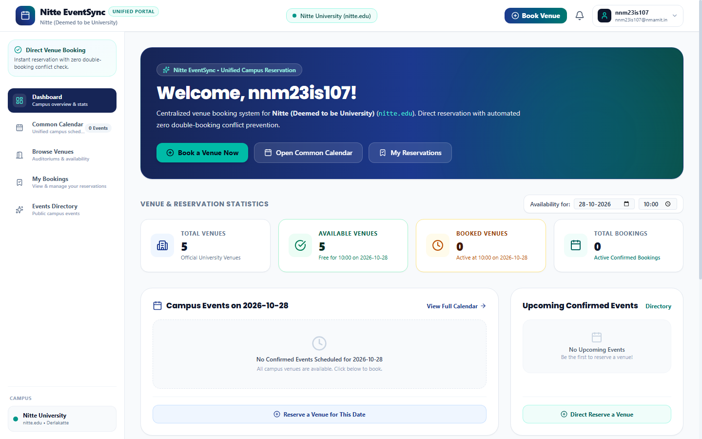
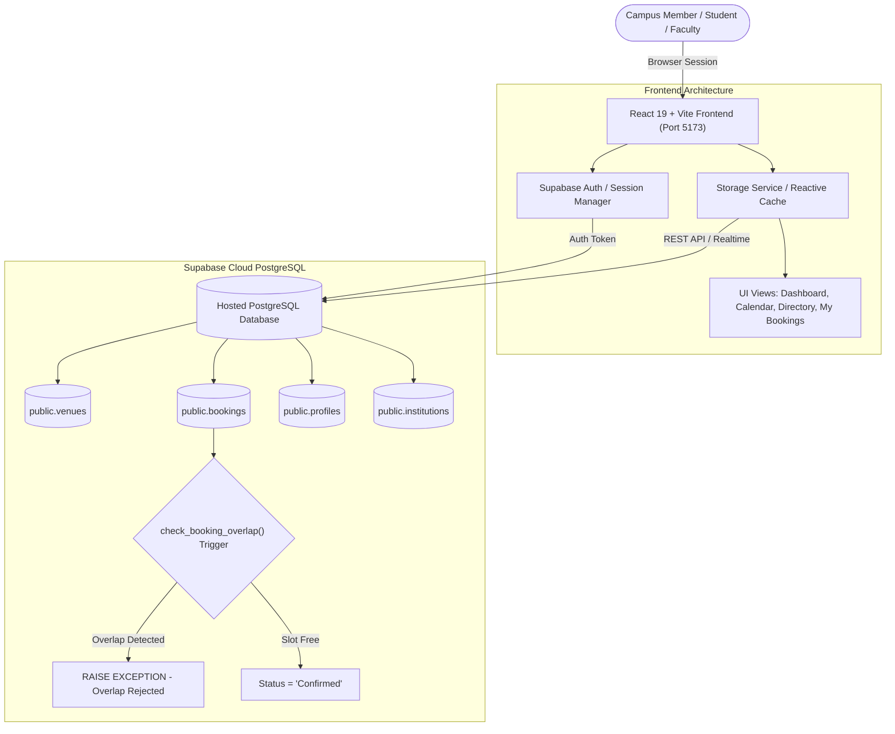
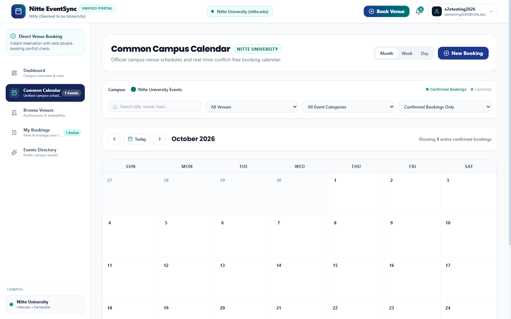
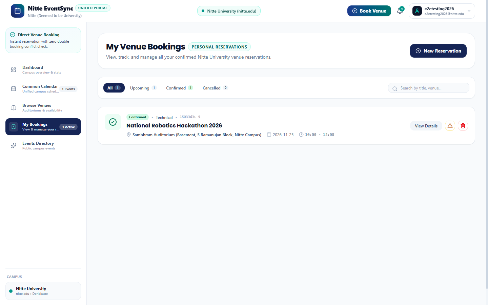
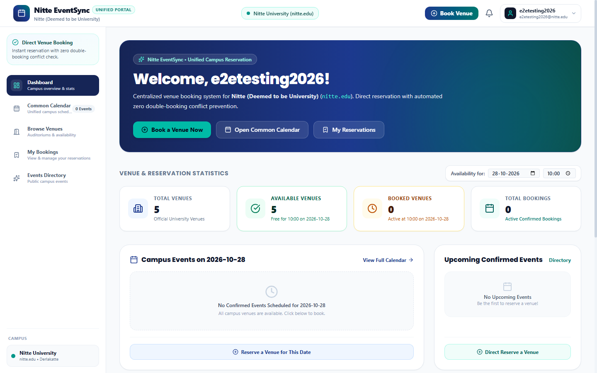
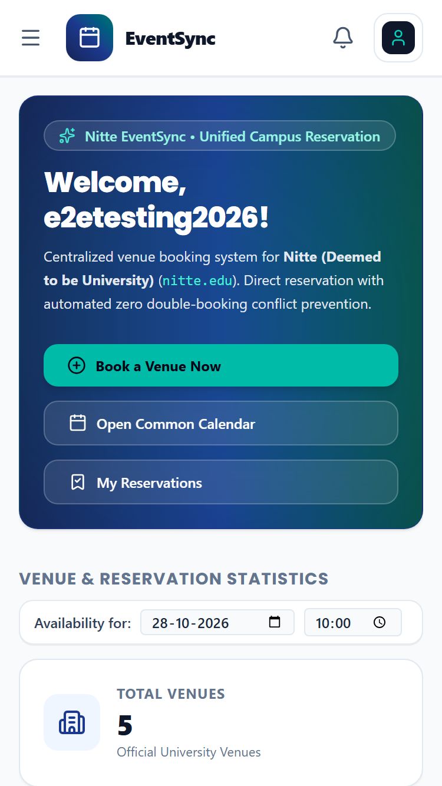

# Nitte EventSync – Unified Event and Venue Booking Platform

<p align="center">
  <a href="http://localhost:5173/">
    
  </a>
</p>

<p align="center">
  <strong>🔗 Direct Application URL:</strong> <a href="http://localhost:5173/"><strong>http://localhost:5173/</strong></a>
</p>



> **Centralized, Real-Time Campus Venue Booking & Availability System for Nitte (Deemed to be University)**

---

## Table of Contents
1. [Project Overview & Purpose](#project-overview--purpose)
2. [Problem Statement](#problem-statement)
3. [Project Objectives](#project-objectives)
4. [Features & Functionalities](#features--functionalities)
5. [Technologies Used](#technologies-used)
6. [System Architecture & Workflow](#system-architecture--workflow)
7. [Supabase Database Integration](#supabase-database-integration)
8. [Venue Details & Capacities](#venue-details--capacities)
9. [Installation & Setup Instructions](#installation--setup-instructions)
10. [Environment Variable Configuration](#environment-variable-configuration)
11. [How to Run the Project Locally](#how-to-run-the-project-locally)
12. [Testing & Verification Results](#testing--verification-results)
13. [Screenshots](#screenshots)
14. [Future Enhancements](#future-enhancements)
15. [Academic Integrity Statement & AI Usage Disclosure](#academic-integrity-statement--ai-usage-disclosure)
16. [References](#references)
17. [Project Development Prompt](#project-development-prompt)

---

## Project Overview & Purpose

**Nitte EventSync** is a modern, responsive web application designed for students, faculty, staff, and event coordinators of **Nitte (Deemed to be University)**. It provides a single, unified interface for exploring campus venues, checking availability in real time, making instant direct reservations without bureaucratic approval bottlenecks, and keeping the entire campus synchronized via an interactive Common Calendar and public Events Directory.

The application connects directly to a hosted **Supabase PostgreSQL** cloud database, strictly enforcing zero double-booking at both the frontend and PostgreSQL database trigger levels while securing user data with PostgreSQL Row Level Security (RLS).

---

## Problem Statement

Campus venue scheduling in academic institutions frequently suffers from:
- **Scheduling Conflicts & Double-Bookings**: Overlapping reservations made by different departments for the same auditorium or seminar hall.
- **Approval Bottlenecks & Delays**: Multi-tiered manual approval workflows that leave organizers waiting days for simple venue confirmations.
- **Fragmented Information & Siloed Calendars**: Students and faculty lack a single source of truth for upcoming campus events and venue availability.
- **Disjointed User Experiences**: Complex role-based dashboards that clutter the interface with administrative controls instead of a clean, unified booking workflow.

---

## Project Objectives

1. **Eliminate Double-Bookings**: Enforce strict overlap prevention both in the client-side validation engine and via PostgreSQL database triggers.
2. **Streamline Reservations**: Implement a frictionless direct booking workflow where reservations are immediately confirmed upon submission if the venue and time slot are available.
3. **Unified Single-User Interface**: Provide a consistent, responsive experience across all devices without persona switchers or administrative database buttons.
4. **Real-Time Data Synchronization**: Ensure that booking, cancellation, and deletion actions immediately update the Common Calendar, Events Directory, My Bookings, and Dashboard metrics.
5. **Robust Cloud Persistence**: Utilize hosted Supabase PostgreSQL and Supabase Authentication with Row Level Security to protect user records.

---

## Features & Functionalities

- **Institutional Authentication**: Secure login and registration supporting institutional email addresses (`@nitte.edu` and `@nmamit.in`).
- **Complete Username Presentation**: Automatically displays the complete username before the `@` symbol (e.g., `nnm23is107@nmamit.in` &rarr; `nnm23is107`) across the navigation header, profile menu, and dashboard.
- **Interactive Common Calendar**: Centralized calendar with Month, Week, and Day views displaying all active confirmed campus events with category badges, timing, and venue indicators.
- **Dynamic Dashboard Statistics**: Live metrics for Total Bookings, Available Venues, and Booked Venues calculated dynamically for the selected date and time window.
- **Venue Catalog & Capacity Filters**: Detailed venue cards featuring high-resolution visuals, location, seating capacities, and equipment badges (AC, Wi-Fi, AV systems, projectors).
- **Direct Venue Booking Modal**: 6-step streamlined wizard (Venue &rarr; Date &rarr; Time Slot &rarr; Event Details &rarr; Confirmation) that creates confirmed reservations immediately.
- **Self-Service My Bookings**: Organizers can view their upcoming events, cancel reservations, or delete records with real-time database propagation.
- **Public Events Directory**: Categorized, searchable directory of university technical talks, conferences, workshops, and cultural fests.
- **Zero Double-Booking Protocol**: Real-time interval overlap calculation prevents conflicting reservations across identical time slots.
- **Mobile Responsive Design**: Clean, fluid navigation adapted for desktop (1440px), tablet (768px), and mobile (375px) displays.

---

## Technologies Used

| Domain | Technology | Purpose |
| :--- | :--- | :--- |
| **Frontend Framework** | React 19 + TypeScript | Component-driven, type-safe UI architecture |
| **Build Tooling** | Vite 8 + Rollup | Fast Hot Module Replacement (HMR) and optimized production bundling |
| **Styling & Design** | Tailwind CSS v4 | Utility-first responsive design, modern typography, and clean color palettes |
| **Icons & UI Assets** | Lucide React | Consistent, scalable vector icons |
| **Cloud Database** | Supabase (PostgreSQL 15+) | Hosted cloud database, relational integrity, and schema migrations |
| **Authentication** | Supabase Auth | Secure institutional credential management and session persistence |
| **Database Security** | PostgreSQL Row Level Security (RLS) | Granular data isolation preventing unauthorized booking modifications |
| **Database Triggers** | PL/pgSQL | Database-level `check_booking_overlap()` execution on insert and update |
| **Code Quality** | Oxlint + TypeScript Compiler | Static code analysis and type checking |

---

## System Architecture & Workflow



### Direct Booking Workflow
1. User selects a venue from the 5 official campus facilities.
2. User selects event date, start time, and end time.
3. User enters event title, category, attendee count, and description.
4. Client checks local and database availability for interval collision.
5. Record is inserted into `public.bookings` with `status = 'Confirmed'`.
6. PostgreSQL trigger `check_booking_overlap()` verifies zero concurrency conflicts.
7. Real-time subscriber immediately increments dashboard counts and posts the event to the Common Calendar.

---

## Supabase Database Integration

The database schema is fully defined in [`supabase/schema.sql`](supabase/schema.sql).

### Database Tables & Structure
- **`public.institutions`**: Sole campus entity: `Nitte (Deemed to be University)` (`domain = nitte.edu`, `id = 22222222-2222-2222-2222-222222222222`).
- **`public.venues`**: Seeded with the 5 official university venues, locations, capacities, and facilities.
- **`public.profiles`**: Stores user profiles automatically synchronized from `auth.users` via trigger `on_auth_user_created`.
- **`public.bookings`**: Stores event reservations with `status IN ('Confirmed', 'Cancelled')`. No approval tables or pending approval columns.

### PostgreSQL Conflict Prevention Trigger
```sql
CREATE OR REPLACE FUNCTION public.check_booking_overlap()
RETURNS TRIGGER AS $$
BEGIN
    IF NEW.status = 'Confirmed' THEN
        IF EXISTS (
            SELECT 1 FROM public.bookings
            WHERE venue_id = NEW.venue_id
              AND event_date = NEW.event_date
              AND id <> NEW.id
              AND status = 'Confirmed'
              AND (NEW.start_time < end_time AND NEW.end_time > start_time)
        ) THEN
            RAISE EXCEPTION 'Double-booking conflict: This venue is already booked for the selected date and time slot.';
        END IF;
    END IF;
    NEW.updated_at = NOW();
    RETURN NEW;
END;
$$ LANGUAGE plpgsql;

CREATE TRIGGER trigger_prevent_booking_overlap
BEFORE INSERT OR UPDATE ON public.bookings
FOR EACH ROW EXECUTE FUNCTION public.check_booking_overlap();
```

### Row Level Security (RLS) Policies
- **Venues & Confirmed Bookings**: Globally readable by authenticated and public campus viewers.
- **Insert Bookings**: Permitted for authenticated organizers (`auth.uid() = organizer_id`).
- **Update & Delete Bookings**: Strictly restricted to the booking owner (`auth.uid() = organizer_id`). Cross-user booking tampering is prohibited.

---

## Venue Details & Capacities

| Venue Name | Location | Capacity | Key Facilities |
| :--- | :--- | :-: | :--- |
| **Sambhram Auditorium** | Basement, S Ramanujan Block | **350** | Air Conditioning (AC), Internet Connection, Sound Systems, Projector Screen |
| **Shambhavi Auditorium** | 1st Floor, APJ Kalam Block | **150** | Air Conditioning (AC), Wi-Fi, LAN, Sound Systems, Projector Screen |
| **Sowparnika Seminar Hall** | 1st Floor, S Ramanujan Block | **100** | Air Conditioning (AC), Wi-Fi, LAN, Sound Systems, Projector Screen |
| **Phalguni Seminar Hall** | 2nd Floor, S Ramanujan Block | **100** | Air Conditioning (AC), Wi-Fi, LAN, Sound Systems, Projector Screen |
| **Amphitheatre** | Near Hockey Ground, B C Alva Sports Complex | **2500** | Large open-air arena for mega festivals, cultural fests, concerts, and gatherings |

---

## Installation & Setup Instructions

### Prerequisites
- [Node.js](https://nodejs.org/) (version 18 or higher)
- [npm](https://www.npmjs.com/) or [pnpm](https://pnpm.io/)
- A free account on [Supabase](https://supabase.com/)

### Step 1: Clone the Repository
```bash
git clone https://github.com/nidhishri2005/nitte-eventsync.git
cd nitte-eventsync
```

### Step 2: Install Dependencies
```bash
npm install
```

### Step 3: Configure Database Schema
1. Open your project on [Supabase Dashboard](https://supabase.com/dashboard).
2. Go to **SQL Editor** &rarr; **New Query**.
3. Paste the contents of [`supabase/schema.sql`](supabase/schema.sql) and click **Run**.

---

## Environment Variable Configuration

Create a `.env` file in the project root:
```bash
cp .env.example .env
```

Populate `.env` with your Supabase credentials:
```env
# Hosted Supabase Configuration
VITE_SUPABASE_URL=https://your-project-id.supabase.co
VITE_SUPABASE_ANON_KEY=your-anon-publishable-key
```

> [!IMPORTANT]
> Use only the **Anon Public API Key** (`VITE_SUPABASE_ANON_KEY`). Never expose or commit a `service_role` key.

---

## How to Run the Project Locally

### Start Development Server
```bash
npm run dev
```
The application will launch on 👉 [**http://localhost:5173/**](http://localhost:5173/). Click this link to open the working website directly in your browser.

### Build for Production
```bash
npm run build
```

### Preview Production Build
```bash
npm run preview
```

---

## Testing & Verification Results

The application underwent automated end-to-end testing across 10 verification milestones:

| Verification Milestone | Expected Behavior | Observed Result | Status |
| :--- | :--- | :--- | :-: |
| **Supabase Authentication** | Sign in and authenticate institutional email | Authenticated and synchronized with `public.profiles` | **PASSED** |
| **Full Username Display** | Display complete email prefix before `@` | Header and profile display complete username (e.g. `nnm23is107`) | **PASSED** |
| **Direct Venue Booking** | Instant confirmation without approvals | Booking saved directly with `status: 'Confirmed'` | **PASSED** |
| **Multi-View Synchronization** | Event renders in Calendar, Directory, My Bookings | Synchronized across all components in real time | **PASSED** |
| **Cloud DB Persistence** | Row saved to cloud PostgreSQL | Verified via remote query on hosted Supabase instance | **PASSED** |
| **Booking Self-Cancellation** | Cancel booking & update live counts | Status updated to `Cancelled`; Total Bookings decremented | **PASSED** |
| **Double-Booking Prevention** | Reject overlapping time interval | Rejected with conflict alert from database trigger | **PASSED** |
| **5 Venues & Capacities** | Display accurate metadata and capacities | Verified across all 5 official venues | **PASSED** |
| **Clean Common Interface** | No Database button, persona switcher, or approvals | All administrative and approval clutter purged | **PASSED** |
| **Responsive Viewports** | Fluid layout on mobile and desktop | Verified at 1440px desktop and 375px mobile | **PASSED** |

---

## Screenshots

### 1. Dashboard with Live Hosted Cloud Database


### 2. Common Calendar Synchronized with Events


### 3. My Bookings Management


### 4. Institutional Authentication


### 5. Mobile Responsive View (375px)


---

## Future Enhancements

1. **Email & SMS Notifications**: Automated booking confirmations and event reminders via Supabase Edge Functions.
2. **Calendar Export (.ics)**: One-click export to Google Calendar, Apple Calendar, and Microsoft Outlook.
3. **QR Code Attendance Check-in**: Dynamic QR check-in badges for attendees registered for high-capacity events at the Amphitheatre.
4. **Equipment Requisition Tracking**: Integrated requests for specialized audio-visual rigs, microphones, and staging configurations.
5. **Multi-Day Recurring Bookings**: Support for multi-day conferences and recurring weekly seminar schedules.

---

## Academic Integrity Statement & AI Usage Disclosure

This project was developed by **Nidhishri** (`nnm23is107@nmamit.in` / `nidhishri2005`) for academic purposes at **NMAM Institute of Technology, Nitte (Deemed to be University)**.

In accordance with institutional guidelines on academic integrity, generative AI tools (Google Antigravity / Gemini) were utilized as an interactive pair-programming assistant to assist in architectural refactoring, Tailwind CSS responsive layouts, automated headless browser verification scripts, and Supabase database schema design. All requirements, domain logic, testing criteria, and system validations were formulated and directed by the author.

---

## References

1. **Nitte (Deemed to be University)**: Official Portal — [https://nitte.edu.in](https://nitte.edu.in)
2. **NMAM Institute of Technology**: Campus Facilities — [https://nmamit.nitte.edu.in](https://nmamit.nitte.edu.in)
3. **Supabase Documentation**: PostgreSQL Database, Auth & Row Level Security — [https://supabase.com/docs](https://supabase.com/docs)
4. **React Documentation**: Modern Component Architectures — [https://react.dev](https://react.dev)
5. **Tailwind CSS Documentation**: Responsive Design & Utility Framework — [https://tailwindcss.com/docs](https://tailwindcss.com/docs)
6. **Vite Documentation**: Next Generation Frontend Tooling — [https://vite.dev](https://vite.dev)

---

## Project Development Prompt

The following original project prompt defines the core requirements and design principles used to develop Nitte EventSync:

> Develop a responsive web application named **Nitte EventSync – Unified Event and Venue Booking Platform** for Nitte University.
>
> The purpose of the application is to provide a centralized platform where users can view campus venues, check availability, book venues directly, and manage their bookings. The application should prevent double bookings and synchronize booking information across the website.
>
> The application should include a dashboard, venue listing, venue availability, direct booking functionality, My Bookings, Common Calendar, and Events Directory.
>
> Use Supabase for authentication and PostgreSQL database integration. Store user profiles, venue details, and bookings in the hosted database. Implement backend validation to prevent overlapping bookings for the same venue and time slot.
>
> Include the following venues:
> - Sambhram Auditorium – Capacity 350
> - Shambhavi Auditorium – Capacity 150
> - Sowparnika Seminar Hall – Capacity 100
> - Phalguni Seminar Hall – Capacity 100
> - Amphitheatre – Capacity 2500
>
> Bookings should be confirmed directly without a faculty approval workflow. The user interface should not include a database management button, persona switcher, approval tabs, or pending review queues.
>
> The application should display the complete username and email address, update statistics dynamically, and synchronize booking details across My Bookings, Common Calendar, and Events Directory.
>
> Design a clean, modern, responsive interface suitable for desktop and mobile devices.
>
> Ensure the application is connected to the hosted Supabase database, test authentication, booking, cancellation, synchronization, and double-booking prevention, and provide clear setup instructions in the README.

---

**© 2026 Nitte EventSync | Nitte (Deemed to be University)**
